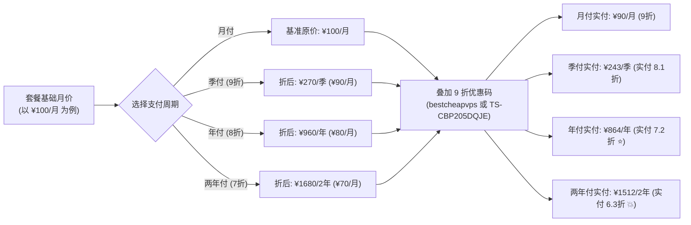
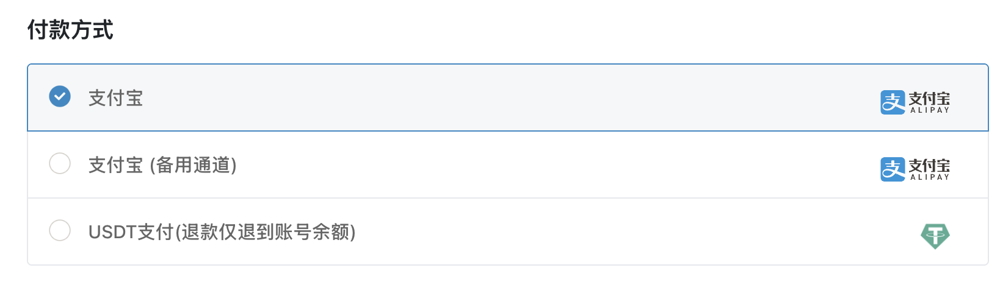
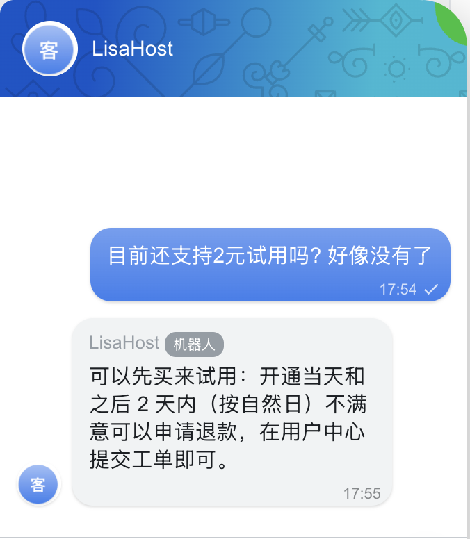
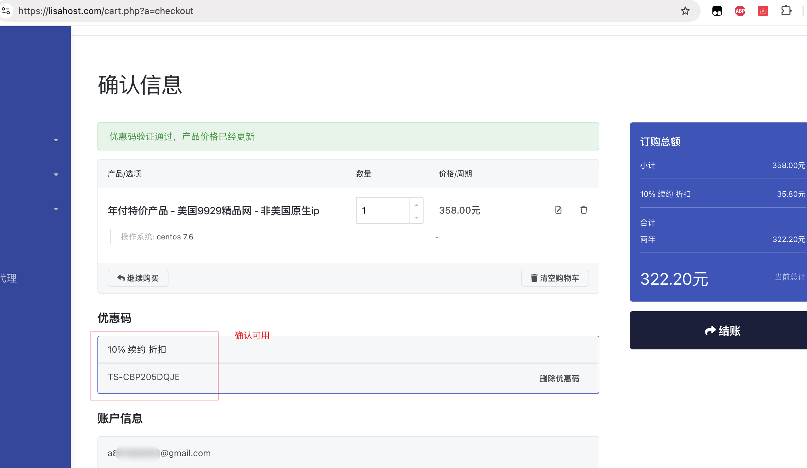
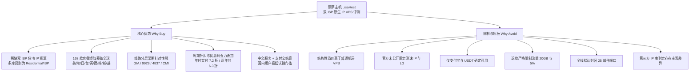

> [!WARNING]
> **阅读前请先确认四件事**：
> * **价格口径**：丽萨主机官网全站以人民币（¥/元）标价，本站数据库同样以 `currency: CNY` 记录，因此本文表格统一用 **¥** 标注。若使用外币卡或 USDT 支付，实际扣款会按支付渠道汇率折算，最终金额以结算页为准。
> * **合规边界**：本文只讨论原生 IP 在**合法合规**业务中的技术价值，**不提供任何绕过平台风控、批量虚假注册、规避实名或规避地域限制的操作方法**。购买与使用须同时遵守服务商 TOS、目标平台用户协议与所在地法律。
> * **信息状态**：支付方式、库存、优惠码均存在「官方口径」与「第三方转述」冲突的情况，下文基于本站购物车真实抓取与自动化核验记录逐项标注，**已确认失效的一律不建议尝试**。
> * **数据免责**：文中第三方延迟、跑分与解锁结论均来自公开测评与采样，受时间、机房、运营商与库存影响，本站未逐一复现；具体套餐配置与网络条件以商家实际业务为准。

在 VPS 这个高度同质化的市场里，大多数商家能拼的只有三样：价格、带宽、线路。丽萨主机（LisaHost）走的是第四条路——**卖 IP 的属性**。

同样是洛杉矶的 1 核 1G，普通商家给你的是一段数据中心 IP，whois 一查就是 hosting；丽萨主机给你的是被 IP 情报库识别为「住宅 / 双 ISP」的地址。这个差别在跑分软件里完全看不出来，但在流媒体合规播放、跨境电商合法后台登录、海外广告投放验证、跨国本地化内容测试这些场景里，往往是「能用」和「不能用」的分界线。

代价也很直接：**贵**。同样 1 核 1G，普通机房年付小鸡可以做到十几美元一年，丽萨主机的住宅 IP 产品线起步就是月付几十元乃至上百元人民币的量级。这篇文章基于本站最新同步的 **168 条全量在库套餐**与真实购物车优惠码核验数据，全面回答这笔溢价买到的到底是什么、周期折扣与优惠码如何叠加最省钱，以及哪些人根本不该买。

---

## 一、认识丽萨主机：一家把「IP」当主产品的商家

丽萨主机是一家**中文团队运营**的服务商，官网、工单、帮助文档均为中文，客服支持中文沟通，这一点对国内用户的操作门槛最低。官网首页长期挂着「即时自动开通、专业在线客服、48 小时不满意无条件退款」的承诺，并提供 **￥2 / 1 天** 的试用入口，说明它对自己的开通流程和 IP 质量有一定信心——至少愿意让你先花两块钱验证。

随着最新数据同步，丽萨主机的产品线已经从早期的单一美西节点大幅扩展到了全球多区域，其产品结构不是按单纯的「便宜 / 贵」分层，而是按 **IP 类型 + 线路类型 + 业务地区** 交叉分层：

* **按 IP 属性**：普通数据中心 IP → 单 ISP 原生 IP → 双 ISP 住宅 IP → 静态住宅 VDS（真实物理住宅宽带出口）。越往右，IP 越「像真人住家」，成本越高。
* **按线路**：普通国际 BGP → 联通 4837 → 联通 9929（CU2） → 电信 CN2 GT → 电信 CN2 GIA（含 CERA 50G 高防）。越往右，国内晚高峰访问越稳，但带宽通常越贵、端口相对收窄。
* **按地区分布**（数据库在库共 **168 条** 套餐）：
  * **美国西部**（洛杉矶为主，53 条）：涵盖 9929 住宅、4837 大带宽、CERA CN2 GIA 高防与真实住宅 VDS；
  * **美国东部**（纽约、芝加哥，17 条）：涵盖芝加哥/纽约 4837 双 ISP 原生家宽、静态住宅 VDS 与 CN2 NAT；
  * **中国香港**（21 条）：涵盖 iCable 有线宽频双 ISP、HGC 双 ISP 家宽、三网直连 CMI / CU2 / CN2；
  * **日本**（21 条）：涵盖 IIJ 双 ISP 静态住宅 VDS、原生住宅 ISP、东京三网优化原生大带宽 VPS；
  * **欧洲**（15 条）：涵盖德国法兰克福双栈双原生（IPv4+IPv6）9929 优化、德国双 ISP VDS 等；
  * **中国台湾**（13 条）：涵盖中华电信 Hinet 动态双 ISP VDS、台湾原生 IP 大带宽 VPS；
  * **英国**（7 条）：伦敦机房，双 ISP 住宅原生 IP 大带宽；
  * **韩国**（7 条）：首尔三网优化，双 ISP 原生住宅静态 IP，主打本土流媒体与短视频业务；
  * **新加坡**（7 条）：新加坡原生 IP 大带宽 VPS 与特价年付系列；
  * **越南**（7 条）：西贡邮电小众运营商双 ISP 原生家宽住宅 IP；
  * **特价年付专区**（33 款各地区特价年付产品）：提供极高折扣力度的包年选择。

在库套餐价格区间从 **¥2**（试用版）一直延伸到 **¥9800**（整机 252 个独立住宅 IP 物理服务器）。这个庞大的 SKU 矩阵意味着你几乎能找到完全符合特定业务属性的 IP 组合，但同时也带来了**极高的选择成本**，不熟悉线路与 IP 特性的用户非常容易买错。

需要提前说明的是，丽萨主机的**自有 ASN 并未公开**，官网也未披露机房等级认证、SLA 赔付细则或成立年份。其上游网络从产品描述与第三方路由测试来看，整合了 China Unicom（AS9929 / AS4837）、China Telecom（163 / CN2）、China Mobile（CMI）、Cogent、HKIX、IIJ 及中华电信 Hinet 等运营商资源。**凡是官方未公开的底层机房细节，本文不做主观揣测。**

---

## 二、双 ISP、原生 IP 与普通 VPS：差别到底在哪

这一节是理解丽萨主机溢价的核心逻辑。很多人常把「原生 IP」和「住宅 IP」混为一谈，实际上在网络层与风控识别上有着严格的分级：

| IP 类型 | 典型归属 | 检测工具表现 | 平台信任度 | 常见价格带 |
| :--- | :--- | :--- | :--- | :--- |
| 广播 / 机房 IP | 传统数据中心机房 | `hosting` / `data center` | 低，极易触发验证 | 最低（普通小鸡） |
| 单 ISP 原生 IP | 当地注册，但归属仍偏机房 | 部分库识别为 ISP，部分仍显示机房 | 中等 | 中等 |
| 双 ISP 住宅 IP | 同时关联两个本地运营商 ASN | 多库识别为 `residential` / `ISP` | 较高，通过率佳 | 高（丽萨主力产品） |
| 静态住宅 VDS | 真实民房物理宽带出口 | 纯家庭宽带特征，独享带宽/IP | 最高 | 最高（独享资源） |

**「双 ISP」的技术含义**：一个 IP 在权威 IP 情报库（如 IPinfo、Scamalytics、MaxMind）中同时关联两个不同的互联网服务提供商（ASN）信息。例如一个 ASN 属于基础承载网，另一个 ASN 属于本地住宅固网宽带运营商。第三方检测工具读取后，会将其判定为 Residential ISP 而非普通机房。所谓「双」并不是给你分配两个独立 IP，而是**归属属性上的双重背书**，使得该 IP 具备高度仿真的家庭宽带属性。

**「原生」的技术含义**：IP 的注册登记地（Whois 所在地）与服务器物理使用地完全一致，并非从第三方国家或地区跨域广播而来。原生解决的是「地理真实性与解析一致性」，而双 ISP 解决的是「像不像真实网民」。两者在丽萨主机的高端产品线上通常是叠加提供的。

这里必须明确泼一盆冷水：**全球各大商业 IP 库与平台风控模型是会打架的**。

第三方测评曾对丽萨主机的样本节点进行跨库比对：同一个 IP 在 ipapi 上可能被标记为较高风险，在 IPQS 上显示为 Suspicious，而在 IP2Location、Scamalytics、AbuseIPDB 与 DB-IP 上却能拿到全绿的低风险评分。

> 数据来源：十星测评公开样本评测（<https://www.shixingceping.com/14223.html>）

这一实测现象揭示了两个不可推翻的事实：
1. **没有任何商家能保证「100% 永久全绿」**，市面上任何宣传「绝对不封、永无风控」的承诺均属于虚假夸大；
2. 平台的风控策略动态变化，除了 IP 纯净度，还会综合评估设备指纹、浏览器环境、Cookie 历史与行为特征。

> 💡 **一句话看清溢价本质**：你多付的钱，买的不是 CPU 跑分和带宽吞吐，而是「这段 IP 在第三方风控数据库里长什么样」。如果你的业务只是跑个 Docker、放个个人博客或做个数据备份，买住宅 IP 就是纯粹的资金浪费。

---

## 三、线路选型：CN2 GIA、9929、4837 与 CMI 的差异

在丽萨主机的 168 款产品中，线路标签种类繁多。抛开包装名词，对实际网络体验起决定性作用的核心骨干主要有以下五类：

| 线路类型 | 运营商骨干 | 国内回程体验 | 典型带宽端口 | 适用业务场景 |
| :--- | :--- | :--- | :--- | :--- |
| **CN2 GIA** | 中国电信精品承载网 | 三网回程最稳，晚高峰抗拥塞极强 | 10~50 Mbps | 生产建站、低延迟 API 交互、延迟敏感型业务 |
| **CN2 GT** | 中国电信优质骨干 | 优于普通 163，高峰期弱于 GIA | 30~100 Mbps | 香港低延迟中转、中等预算站点 |
| **AS9929 (CU2)** | 中国联通精品网 | 联通极佳（媲美 GIA），电信次之 | 50~100 Mbps | 联通主力用户、高质量跨国传输、德国双栈优化 |
| **AS4837** | 中国联通普通国际骨干 | 联通直连跑满，电信/移动高峰跨网有波动 | 300~1000 Mbps | 大带宽吞吐、大流量住宅 IP 运营、内容拉取 |
| **CMI** | 中国移动国际骨干 | 移动用户友好，亚太互联延迟极低 | 50~100 Mbps | 移动宽带群体、香港/亚太节点业务 |

### 1. CN2 GIA：贵在晚高峰的确定性
CN2 GIA（AS4809）是电信面向高端企业客户的精品网络，全程经过 59.43 精品节点回国。其核心价值在于晚高峰（20:00–23:00）几乎不丢包、延迟稳定。但其带宽采购成本极高，因此丽萨主机的 CN2 GIA 套餐端口通常只给 10~15 Mbps，且流量偏小。此外，其 **CERA 高防系列** 还默认集成了 CERA 机房的 50G DDoS 清洗能力，专为容易遭遇网络攻击的高防建站场景设计。

### 2. AS9929：高性价比精品网
联通 9929 是联通的精品承载网（常称 CU2）。联通用户访问体验丝毫不输电信 CN2 GIA，电信走 9929 回国同样平稳。丽萨主机的美西 9929 住宅 IP 系列以及最新上线的**德国法兰克福双栈优化 VPS**（同时分配原生 IPv4 + 原生 IPv6），均走 AS9929 骨干回国，在保证纯净 IP 的同时兼顾了三网连接品质。

### 3. AS4837：大带宽跑量利器
AS4837 是联通的普通民用国际骨干网，带宽单价比精品网低得多。因此商家能大方给出 300 Mbps、500 Mbps 乃至 1 Gbps 的超大端口和数 TB 流量，价格只要 ¥68/月 起。第三方测评显示，联通用户全天可跑满；但电信和移动用户在晚高峰需要跨运营商互联互通回传，会有小幅延迟上升和偶尔轻微丢包。对于需要大带宽吞吐的住宅 IP 业务，这是性价比极高的主力线路。

> ⚠️ **注意去回程非对称**：跨国 VPS 的去程与回程经常走不同路由。去程可能走普通 163，回程走 4837 或 9929。评价网络质量必须以**回程 MTR 路由**为准，切勿仅凭去程 traceroute 下结论。

---

## 四、原生 IP 的用途与合规边界

原生/住宅 IP 拥有明确的技术应用价值，但在使用过程中存在极为清晰的法律与服务协议红线。

### 1. 合理合规的业务用途
* **合规流媒体观看**：用户拥有相关流媒体平台的正规付费订阅账号，利用该 IP 获得所在地区的标准音画质传输体验；
* **跨境电商自营店铺维护**：拥有合法海外店铺经营资质的跨境卖家，使用固定纯净 IP 进行日常合规登录与商品上传，避免多地漂移触发系统误判；
* **海外 SaaS 与 AI 工具日常办公**：部分企业级工具对数据中心机房 IP 段有严格安全拦截，使用住宅 IP 可保持常规访问顺畅；
* **数字营销与广告投放验证**：广告团队在目标受众区域验证落地页展现、汇率计价与素材合规性；
* **跨国网络兼容性与 CDN 调试**：跨国企业技术人员测试全球 CDN 调度是否准确识别人群地理归属。

### 2. 严禁触碰的违规红线
* **严禁用于批量注册、矩阵养号**：任何平台的用户协议均严禁利用多 IP 批量制造虚假账户，此举既违反 TOS 亦涉嫌黑灰产违法；
* **严禁用于绕开金融 KYC、身份认证或欺诈**：使用假造居住地信息冒领区域福利或套现属于欺诈行为；
* **严禁滥用发送垃圾邮件（Spam）与网络攻击**：丽萨主机严格执行 Abuse Policy，其全线服务器默认封闭 25 端口，且滥用行为将导致立即封机且不退款；
* **严禁把「IP 黑名单 24 小时免费更换」当成消耗品**：服务商提供的更换政策属于线路偶发故障的补救措施，并非违规滥用的试错许可证。频繁触发黑名单的用户会被直接终止服务。

> 💡 **核心合规法则**：评估一项业务是否可行，标准在于：**如果将操作移至该国当地居民的家庭电脑上执行，是否合法合规？** 若在当地同样违规，则更换任何住宅 IP 均无法消除法律与封禁风险。

---

## 五、套餐矩阵与价格拆解

从丽萨主机目前在库的 **168 条** 全量套餐中，我们精选了 16 款覆盖不同区域、不同线路与 IP 属性的**核心代表性套餐**。所有数据均已对齐官方实时配置，直达链接均经过校验。

### 1. 核心代表性套餐矩阵

| 套餐名称 | 机房 / 线路 | 硬件配置 | 流量 / 端口 | 标价口径 | 购买直达 |
| :--- | :--- | :--- | :--- | :--- | :--- |
| 美国 CN2 GIA 精品网络 基础版 1G | 洛杉矶 / CN2 GIA | 1C / 1GB / 20GB SSD | 500GB @ 15 Mbps | ¥122 / 季（约¥40.7/月） | [查看套餐]( https://vps-craft.com/go/lisahost-us-cn2gia-basic) |
| 美国 CERA CN2 高防 精简版 512M | 洛杉矶 CERA / GIA 高防 | 1C / 512MB / 10GB SSD | 100GB @ 10 Mbps | ¥40 / 月 | [查看套餐]( https://vps-craft.com/go/lisahost-us-cera-cn2gia-p36) |
| 美国 CERA CN2 高防 基础版 1G | 洛杉矶 CERA / GIA 高防 | 1C / 1GB / 20GB SSD | 500GB @ 15 Mbps | ¥50 / 月 | [查看套餐]( https://vps-craft.com/go/lisahost-us-cera-basic) |
| 美国 CERA CN2 GIA 进阶版 2G | 洛杉矶 CERA / GIA 高防 | 2C / 2GB / 20GB SSD | 200GB @ 25 Mbps | ¥256 / 季 | [查看套餐]( https://vps-craft.com/go/lisahost-us-cn2-gia-2g) |
| 美国 4837 双 ISP 住宅 基础版 | 洛杉矶 / 4837 家宽 | 1C / 1GB / 20GB NVMe | 3TB @ 300 Mbps | ¥68 / 月 | [查看套餐]( https://vps-craft.com/go/lisahost-us-4837-dualisp-basic) |
| 美国 4837 双 ISP 住宅 进阶版 | 洛杉矶 / 4837 家宽 | 2C / 2GB / 40GB NVMe | 8TB @ 500 Mbps | ¥100 / 月 | [查看套餐]( https://vps-craft.com/go/lisahost-us-4837-dualisp-advanced) |
| 香港 三网直连 CN2 GT 基础版 1G | 香港 / CN2 GT | 1C / 1GB / 20GB NVMe | 1TB @ 30 Mbps | ¥88 / 月 | [查看套餐]( https://vps-craft.com/go/lisahost-hk-cn2-gt-1g) |
| 香港 iCable 双 ISP 住宅 1G | 香港 / 双 ISP 家宽 | 1C / 1GB / 10GB NVMe | 2TB @ 100 Mbps | ¥88 / 月 | [查看套餐]( https://vps-craft.com/go/lisahost-hk-icable-1g-10g) |
| 香港 iCable 双 ISP 住宅 2G | 香港 / 双 ISP 家宽 | 2C / 2GB / 40GB NVMe | 6TB @ 200 Mbps | ¥299 / 月 | [查看套餐]( https://vps-craft.com/go/lisahost-hk-icable-2g) |
| 香港 三网直连 CMI KVM 1G | 香港 / CMI 直连 | 1C / 1GB / 10GB NVMe | 600GB @ 50 Mbps | ¥566 / 年 | [查看套餐]( https://vps-craft.com/go/lisahost-hk-cmi) |
| 台湾 双 ISP 大陆优化 KVM 1G | 台湾 / 双 ISP 优化 | 1C / 1GB / 10GB NVMe | 2TB @ 100 Mbps | ¥766 / 年 | [查看套餐]( https://vps-craft.com/go/lisahost-tw-isp) |
| 日本 原生 IP 大带宽 进阶版 2G | 日本东京 / 原生优化 | 2C / 2GB / 20GB NVMe | 8TB @ 500 Mbps | ¥158 / 月 | [查看套餐]( https://vps-craft.com/go/lisahost-jp-native-advanced-month) |
| 日本 原生住宅 ISP 1G | 日本东京 / 双 ISP 住宅 | 1C / 1GB / 20GB NVMe | 3TB @ 300 Mbps | ¥169 / 月 | [查看套餐]( https://vps-craft.com/go/lisahost-jp-residential-1g) |
| 英国 双 ISP 住宅原生 IP 1G | 英国伦敦 / 双 ISP 住宅 | 1C / 1GB / 10GB NVMe | 6TB @ 300 Mbps | ¥68 / 月 | [查看套餐]( https://vps-craft.com/go/lisahost-uk-dualisp-1g) |
| 洛杉矶 9929 原生 IP KVM 1G | 洛杉矶 / AS9929 | 1C / 1GB / 10GB SSD | 400GB @ 50 Mbps | ¥299 / 年 | [查看套餐]( https://vps-craft.com/go/lisahost-la-9929-native) |
| 美国芝加哥 住宅 IP VDS 年付 1G | 芝加哥 / 静态住宅 VDS | 1C / 1GB / 10GB NVMe | 600GB @ 100 Mbps | ¥399 / 年 | [查看套餐]( https://vps-craft.com/go/lisahost-chicago-residential-vds-year) |

### 2. 扩容特色节点与特价年付系列推荐

除了上述常规主力款，针对近期扩容上线的热门特殊产品线，以下几款同样具备很高的关注度：

* **德国双栈 9929 优化 VPS（基础版）**：法兰克福节点，分配**原生 IPv4 + 原生 IPv6**，三网走 AS9929 精品骨干回国，1C / 1G / 10G NVMe / 300 Mbps / 1000GB，月付 ¥68。直达：[查看德国9929基础版]( https://vps-craft.com/go/lisahost-de-9929-basic-m)。
* **韩国双 ISP 原生住宅家宽 VPS（基础版）**：首尔机房，低延迟优化，三网直连，主打韩国本土流媒体与短视频运营，1C / 1G / 10G NVMe / 50 Mbps / 600GB，月付 ¥99。直达：[查看韩国双ISP基础版]( https://vps-craft.com/go/lisahost-kr-dualisp-p128)。
* **台湾中华电信 Hinet 动态双 ISP VDS**：支持后台一键更换动态家庭宽带 IP，适合对 IP 灵活性要求极高的专业业务，1C / 1G / 10G NVMe / 100 Mbps / 3000GB，月付 ¥399。直达：[查看台湾Hinet动态VDS]( https://vps-craft.com/go/lisahost-tw-hinet-1)。
* **【特价年付】美国 4837 双 ISP 住宅年付版**：常年畅销的特价包，1C / 1G / 10G NVMe / 300 Mbps / 1000GB/月，标价 ¥399/年，叠加优惠码后仅需 **¥359.1/年**。直达：[查看4837特价年付版]( https://vps-craft.com/go/lisahost-us-la-4837-dualisp-p169)。

---

### 3. 周期折扣与优惠码叠加机制（省钱核心）

在丽萨主机的 WHMCS 结算系统中，有一套非常实用的**周期折扣与优惠码双重叠加**机制：

#### 官方周期基础折扣：
* **季付**：系统自动打 **9 折**（扣减 10%）；
* **年付**：系统自动打 **8 折**（直接省掉 20% 基准总价，相当于买 10 个月送 2 个月）；
* **两年付**：系统自动打 **7 折**（直接省掉 30% 基准总价）。

#### 叠加全场通用 9 折优惠码后的实际到手折扣：
丽萨主机的长期全场通用 9 折优惠码（如 `bestcheapvps` 或 `TS-CBP205DQJE`）支持与上述周期折扣**乘积叠加**，并且是 **Recurring（循环折扣，续费同价）**：
* **季付叠加 9 折码**：`0.90 × 0.90 = 0.81` → **实付 8.1 折**（相比月付立省 19%）；
* **年付叠加 9 折码**：`0.80 × 0.90 = 0.72` → **实付 7.2 折**（相比月付累计节省高达 **28%**）；
* **两年付叠加 9 折码**：`0.70 × 0.90 = 0.63` → **实付 6.3 折**（相比月付累计节省高达 **37%**）；
* **特价年付产品叠加**：即使是官方已经大幅打折的「特价年付专区」（如标价 ¥399/年的特价机型），在结账时填入 9 折优惠码依然可以再享 9 折，实付只需 **¥359.1/年**。

> 💡 **购买策略建议**：
> 如果是初次接触丽萨主机某个机房的 IP 段，**强烈建议先花 ¥2 买 1 天试用**，或先以月付方式验证 IP 属性与流媒体解锁状态；确认 IP 表现符合业务预期且长期需要后，再升级为**年付（实付 7.2 折）**或**两年付（实付 6.3 折）**锁定超低续费单价。

---

## 六、支付方式、退款与官方测速

### 1. 支付方式核验
针对网上各类返佣软文中五花八门的付款描述，本站通过真实订单结账环节核实如下：

| 支付渠道 | 核实状态 | 结算说明 |
| :--- | :--- | :--- |
| **支付宝 (Alipay)** | ✅ 已支持 | 官网原生以人民币（CNY/￥）标价并结算，国内用户零门槛直接扫码支付 |
| **USDT (加密货币)** | ✅ 已支持 | 官网收银台支持 USDT 等加密资产付款，适合海外及隐私需求用户 |
| 微信支付 | ⚠️ 未核实 | 常见于软文转述，结账界面未直接集成，不能当作可用渠道 |
| PayPal | ⚠️ 未核实 | 实测长文指出当前未支持常规 PayPal 通道，勿以二手教程为准 |
| 国际信用卡 (Visa/Mastercard) | ⚠️ 未核实 | 暂未集成独立 Stripe 刷卡网关，目前主要通过人民币或加密网关承兑 |

结论：**请把丽萨主机视为「支付宝 + USDT」双通道商家**。国内用户直接用支付宝最便捷稳妥。

### 2. 退款政策：48 小时保障与细节门槛
官方英文 TOS（Terms of Service）明确规定：服务开通后 **48 小时内** 可申请取消并全额退款。但务必注意以下免责限制条款：
* **流量红线**：退款申请时，已用流量不得超过套餐总配额的 **5%**，且绝对使用量不得超过 **20GB**（两者以先到达者为准）。一旦超过，视为重度使用，不支持退款；
* **手续费与附加费**：初装调试费与支付网关产生的手续费不予退还；
* **滥用违规**：触发 Abuse Policy（如发垃圾邮件、端口扫描等）直接终止服务，不予退款；
* **特殊机型与 USDT 规则**：家庭宽带 VDS 等特殊标注产品以及使用 USDT 支付的订单，退款时款项只退回为**丽萨主机账户站内余额**，无法原路退现。

> 💡 **避坑提示**：机器开通后的头两个小时内，迅速完成回程 MTR、IP 属性查询与轻量测速，测试流量控制在 1~2GB 以内。千万不要等到跑了几十 GB 流量或超过 48 小时再去申请退款。

### 3. 测速与 Looking Glass 现状
本站测速数据库长期跟踪显示，截至 2026 年底，**丽萨主机官方并未公开固定、永久的测速 Looking Glass 或官方统一测速大文件**。官方仅在特定产品页面提供临时样本 IP，但随着机房 IP 段轮转，样本经常更替。

**最可靠的三步自检方案**：
1. **官方 ¥2 / 1 天试用**：直接花 2 块钱开通真实机器，全功能实测，这是最直接可靠的真机验证(是否是2元待定)；

2. **Ping 官网与登录节点**：测试到达商家入口网关的基础延迟与丢包表现；
3. **交付后即时 MTR 检查**：登录 VPS 执行 `mtr -rw <本地IP>`，核实回程路由是否与套餐标称（CN2 GIA / 9929 / 4837）完全一致。

---

## 七、优惠码、优缺点与决策清单

### 1. 优惠码：购物车真实核验日志

本站系统对丽萨主机的常用优惠码在真实下单购物车（Cart Checkout）中进行了逐一调用测试，测试机型覆盖美西 9929、4837 及 CERA 系列，最新实测结果如下表所示：

| 优惠码 | 折扣力度 | 循环属性 | 购物车核验状态 | 实测返回详情 | 推荐指数 |
| :--- | :--- | :--- | :--- | :--- | :--- |
| `bestcheapvps` | 全场 9 折 | Recurring（续费同价） | ✅ **实测有效 (status: ok)** | 提示「优惠码验证通过，产品价格已经更新」 | ⭐⭐⭐⭐⭐ (首选) |
| `TS-CBP205DQJE` | 全场 9 折 | Recurring（续费同价） | ✅ **实测有效 (status: ok)** | 提示「优惠码验证通过，产品价格已经更新」 | ⭐⭐⭐⭐⭐ (首选) |
| `idcspy` | 全场 9 折 | Recurring（续费同价） | ✅ **实测有效 (status: ok)** | 提示「优惠码验证通过，产品价格已经更新」 | ⭐⭐⭐⭐ |
| `20240101-OFF` | 全场 9 折 | Recurring（续费同价） | ✅ **实测有效 (status: ok)** | 提示「优惠码验证通过，产品价格已经更新」 | ⭐⭐⭐⭐ |
| `LISANEW10` | 标称新客9折 | — | ❌ **实测失效 (status: gg)** | 提示「您输入的优惠码不存在」 | ⛔️ 请勿使用 |
| `WN-C2AAZS429Q` | 标称CERA 9折 | — | ❌ **实测失效 (status: gg)** | 提示「优惠码已过期」 | ⛔️ 请勿使用 |

> 💡 **下单须知**：推荐在结算时直接输入 **`bestcheapvps`** 或 **`TS-CBP205DQJE`**。在点击「验证代码」后，请务必核对总金额是否成功下调 10%（例如月付 68 元降为 61.2 元，年付 399 元降为 359.1 元）再扫码付款。

---

### 2. 优缺点全景

#### 优点剖析
1. **IP 属性壁垒极高**：在 168 款产品中，双 ISP 住宅及原生 IP 占绝大多数，且覆盖范围从美洲拓展到了欧洲、东亚及东南亚，解决了大量出海业务对本地化家庭宽带 IP 的刚需；
2. **线路与网络多样化**：不盲目主打昂贵的 CN2 GIA，既有大带宽跑量的 4837，也有高品质的 9929 与双栈德国优化线路，配置灵活；
3. **折扣叠加力度扎实**：年付 8 折与两年付 7 折配合通用 9 折优惠码，可将实际成本分别压至 7.2 折与 6.3 折，且续费同价，长期持有成本显著降低；
4. **服务适配中文用户**：全中文支持、工单响应及时，支持支付宝直接以人民币结算；
5. **硬件性能中规中矩**：主流套餐标配 NVMe 高速固态与 KVM 架构，磁盘随机读写与稳定性足以胜任日常运维。

#### 缺点与风险提示
1. **价格溢价显著**：对于纯建站或测试开发用户而言，同等预算在普通机房（如 RackNerd、CloudCone）可以买到数倍的硬件资源与流量；
2. **官方测速透明度不足**：缺少固定公开的 Looking Glass，买前必须借助试用或自检手段；
3. **退款门槛需格外留心**：20GB 流量红线极易在盲目的大文件测速中被耗尽；家宽 VDS 及 USDT 退款仅退站内余额；
4. **25 端口永久封禁**：上游防范垃圾邮件策略严格，无法作为邮件服务器使用；
5. **IP 段需要维护心智**：没有所谓「永不风控」的神仙 IP，必须规范使用，避免因粗暴操作导致 IP 被情报库列入黑名单。

---

### 3. 明确不适合的人群

* **预算极低、追求极致性价比的机房玩具党**：若每年预算仅几十元人民币，请直接移步 [RackNerd 20 美元以内推荐](/docs/racknerd-vps-under-20-usd-recommendations) 或 [CloudCone 15 美元以内推荐](/docs/cloudcone-vps-under-15-usd-and-best-value-recommendations)；
* **单纯面向国内用户的常规建站站长**：住宅 IP 的路由优势在于海外平台信任度，纯做站请直接选择 [搬瓦工 CN2 GIA 系列](/docs/bandwagonhost-vps-review-2026) 等国内极致优化方案；
* **邮件营销与自建 SMTP 邮局用户**：25 端口全网封闭，不可用；
* **视频转码、高负载持续编译用户**：CPU 核心为常规共享虚拟化，不适合长期占满计算；
* **试图批量养号、对抗平台底层风控者**：风控是全链路立体对抗，单靠住宅 IP 无法规避行为指纹与关联封禁，违规操作将被服务商封机且不退款。

---

### 4. 场景决策清单

请按实际业务诉求对号入座，直达链接均经过核验并在新标签页中打开：

* **想低成本验证纯正 CN2 GIA 电信线路** → [美国 CN2 GIA 基础版 1G · 季付¥122（折合约¥40.7/月）]( https://vps-craft.com/go/lisahost-us-cn2gia-basic)
* **需要 CERA 高防 50G 防御 + GIA 回程建站** → [美国 CERA CN2 GIA 基础版 1G · ¥50/月]( https://vps-craft.com/go/lisahost-us-cera-basic)
* **联通宽带用户、需要 300M 大带宽住宅 IP 跑量** → [美国 4837 双 ISP 住宅 基础版 · ¥68/月]( https://vps-craft.com/go/lisahost-us-4837-dualisp-basic)
* **追求极高性价比的美西住宅 IP 年付方案** → [【特价年付】美国 4837 双 ISP 住宅 · ¥399/年（叠码后¥359.1）]( https://vps-craft.com/go/lisahost-us-la-4837-dualisp-p169)
* **香港超低延迟 + 原生双 ISP 家宽** → [香港 iCable 双 ISP 住宅 1G · ¥88/月]( https://vps-craft.com/go/lisahost-hk-icable-1g-10g)
* **日本东京原生大带宽节点** → [日本 原生 IP 大带宽 进阶版 2G · ¥158/月]( https://vps-craft.com/go/lisahost-jp-native-advanced-month)
* **日本住宅属性要求极高的本地化业务** → [日本 原生住宅 ISP 1G · ¥169/月]( https://vps-craft.com/go/lisahost-jp-residential-1g)
* **欧洲德国双栈优化（原生 IPv4+IPv6 三网9929）** → [德国 9929 双栈双原生 基础版 1G · ¥68/月]( https://vps-craft.com/go/lisahost-de-9929-basic-m)
* **欧洲英国双 ISP 纯净出口** → [英国 双 ISP 住宅原生 IP 1G · ¥68/月]( https://vps-craft.com/go/lisahost-uk-dualisp-1g)
* **台湾本地原生业务与双 ISP 优化** → [台湾 双 ISP 大陆优化 KVM 1G · ¥766/年]( https://vps-craft.com/go/lisahost-tw-isp)
* **预算有限、想体验精品 9929 原生 IP** → [洛杉矶 9929 原生 IP KVM 1G · ¥299/年]( https://vps-craft.com/go/lisahost-la-9929-native)
* **真实美国家庭物理宽带出口（静态住宅 VDS）** → [美国芝加哥 住宅 IP VDS 年付 1G · ¥399/年]( https://vps-craft.com/go/lisahost-chicago-residential-vds-year)

---

### 总结结语

原生住宅 IP 本质上是一门**为网络身份溢价买单**的技术方案。在丽萨主机扩容至 168 款产品的矩阵中，通过清晰梳理「线路类别」与「IP 归属」，并善用**年付 8 折 / 两年付 7 折叠加 `bestcheapvps` 9 折优惠码**（实付 7.2 折 / 6.3 折）的复利机制，可以显著拉低长期持有成本。下单前务必花 2 元试用或月付验证段位，用冷静客观的技术评估代替盲目追捧，才能让每一分预算真正发挥最大的业务价值。
